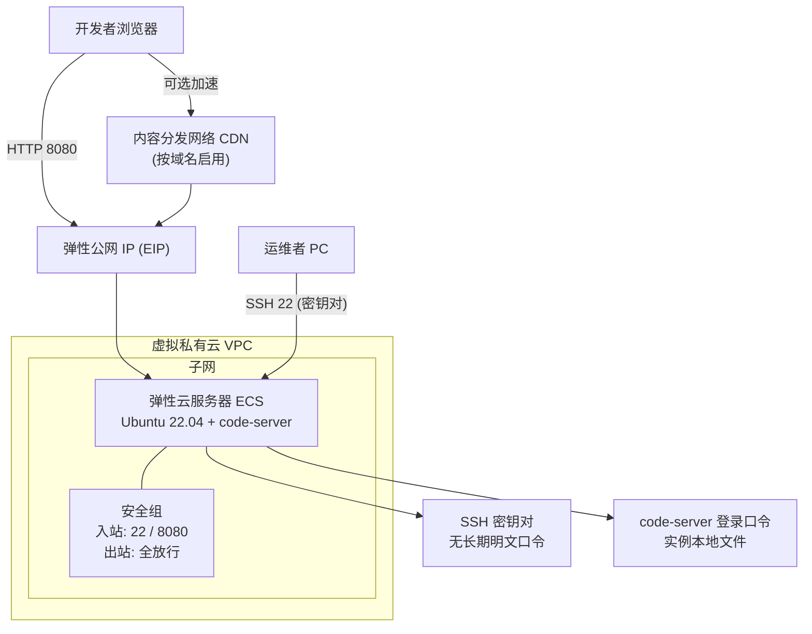

# 架构说明

## 1. 架构总览

本实践在华为云上部署一套**浏览器访问的云端开发环境（code-server）**：在一台弹性云服务器（ECS）上运行 Ubuntu 22.04 与 code-server，通过弹性公网 IP（EIP）对外暴露 Web 访问入口（8080 端口），并可选接入内容分发网络（CDN）为跨地域访问提供加速。开发者只需一个浏览器即可获得一致、可随时访问的 IDE 环境，无需本地安装。

安全边界由虚拟私有云（VPC）、子网、安全组与 SSH 密钥对共同构成：SSH 登录与 code-server 访问端口分别在安全组中显式放行；code-server 的初始登录口令保存在实例本地文件，仅登录实例后可读取。



## 2. 组件与职责

| 组件 | 服务 | 职责 |
|---|---|---|
| 网络隔离 | 虚拟私有云 VPC + 子网 | 为开发环境提供独立的私网地址空间 |
| 公网入口 | 弹性公网 IP EIP | 绑定 ECS，提供固定的公网 Web 访问地址 |
| 访问加速 | 内容分发网络 CDN | 可选，按域名启用，改善跨地域访问延迟 |
| 访问控制 | 安全组 | 分别放行 SSH(22) 与 code-server(8080) 入站，出站默认放行 |
| 计算 | 弹性云服务器 ECS | 运行 Ubuntu 22.04 与 code-server，规格由变量指定 |
| 登录凭据 | SSH 密钥对 | 运维者以密钥对登录实例，避免口令登录 |
| 应用口令 | 实例本地口令文件 | code-server 首次登录口令，保存在实例本地 |
| 镜像选择 | 镜像服务 | 按区域自动选取可用的 Ubuntu 22.04 公共镜像 |

## 3. 部署形态与访问链路

- **Web 访问链路**：浏览器 →（可选 CDN）→ EIP → ECS 的 8080 端口 → code-server。启用 CDN 时需提供已备案的加速域名，域名配置由变量 `cdn_domain_name` 控制，留空则不创建 CDN 资源。
- **运维链路**：运维者以 SSH 密钥对登录 ECS，读取本地口令文件完成 code-server 首次登录。
- **单实例形态**：默认采用单台 ECS + 单可用区的最小可用部署，适合开发 / 测试场景；生产高可用形态可在该基础上扩展多实例与负载均衡。

## 4. 目录与代码布局

```text
distributed-x-infrastructure-cloud-ide/
├── infra/                       # Terraform 基础设施
│   ├── main.tf                  # provider、ECS、EIP、安全组、CDN 等资源
│   ├── data.tf                  # 镜像与可用区数据查询
│   ├── variables.tf             # 变量声明（区域、规格、密钥、CDN 域名等）
│   ├── outputs.tf               # 输出（公网 IP、访问地址、登录命令等）
│   ├── versions.tf              # provider 版本约束
│   ├── user_data.sh             # 实例初始化脚本（安装 code-server）
│   └── terraform.tfvars.example # 变量示例（占位值，无真实凭据）
├── docs/                        # 架构说明与部署指南
└── README.md                    # 实践说明主文档
```

## 5. 关键设计决策

- **密钥对优先**：`create_keypair` 为真时自动创建密钥对，也可传入已有密钥对名称，便于复用企业既有密钥资产。
- **CDN 按需启用**：仅当 `cdn_domain_name` 非空时创建 CDN 域名资源，避免为本地 / 单地域场景引入不必要的组件。
- **入站端口收敛**：安全组对 22 与 8080 分别建规则；生产环境应把 `internet_cidr_block` 从示例的全网地址收敛到运维者 IP 段。
- **初始化脚本自包含**：实例首次启动时由 `user_data.sh` 完成 code-server 安装与口令生成，无需人工登录配置。

## 6. 设计约束与已知限制

- 单实例部署不含高可用与自动伸缩；如需 7×24 生产服务，应扩展为多实例 + 负载均衡 + 持久化存储。
- code-server 口令以文件形式保存在实例本地，未接入统一身份认证；企业场景应对接组织级 SSO 或访问控制网关。
- 启用 CDN 需使用已完成备案的域名，域名与证书由使用者自行准备。
- 资源销毁与残留检查见部署指南的「清理资源」章节。
